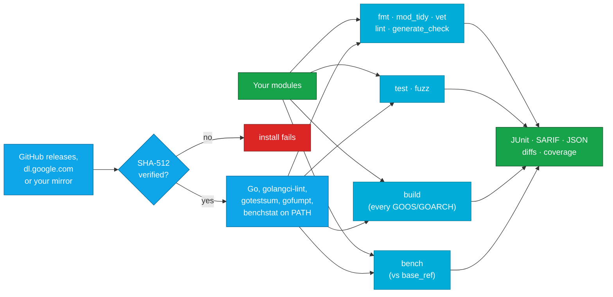

<div align="center">


# Go Quality Orb for CircleCI

### Hold Go code to a standard on every commit: formatting, tidy modules, vet, golangci-lint, generated code, tests, fuzzing, cross-compiling and benchmarks.

Install checksum-verified [Go](https://go.dev/dl/), [golangci-lint](https://golangci-lint.run), [gotestsum](https://github.com/gotestyourself/gotestsum), [gofumpt](https://github.com/mvdan/gofumpt) and [benchstat](https://pkg.go.dev/golang.org/x/perf/cmd/benchstat), and gate builds on what the Go toolchain and they find.<br>
Every module of a monorepo · JUnit, SARIF and diffs · Findings told apart from tools that didn't run · Strict SHA-512 verification by default · No `sudo`

[](https://circleci.com/gh/juburr/go-quality-orb)
[](https://circleci.com/developer/orbs/orb/juburr/go-quality-orb)
[](LICENSE)
[](https://discuss.circleci.com/c/ecosystem/orbs)


**[Quick Start](#-quick-start)** · **[Features](#-why-go-quality-orb)** · **[Recipes](#-recipes)** · **[Commands](#-commands)** · **[Reports](#-reports)** · **[Security](#-secure-by-design)** · **[Network Access](#-network-access)**

<sub>An unofficial, community-maintained orb. [Contributions are welcome!](#-contributing)</sub>

</div>

<br>

## ✨ Why go-quality-orb?

<table>
<tr>
<td width="33%" valign="top">
🧹 <b>The checks reviewers shouldn't have to make</b><br><br>
<code>fmt</code> (gofmt or gofumpt), <code>mod_tidy</code> (<code>go mod tidy -diff</code>), <code>vet</code>, <code>lint</code> (golangci-lint 2) and <code>generate_check</code> (is the generated code up to date?), each failing the step on what it finds and writing the fix as a diff.
</td>
<td width="33%" valign="top">
🧪 <b>Tests that mean something</b><br><br>
<code>test</code> runs gotestsum with the race detector, a shuffled order, coverage and a <code>coverage_min</code> gate, reruns to tell flaky tests apart, and splits heavy suites across parallel nodes by timing. <code>fuzz</code> fuzzes each fuzz test and keeps the inputs that break it.
</td>
<td width="33%" valign="top">
🏗️ <b>Every platform and module</b><br><br>
<code>build</code> compiles each module for every <code>GOOS/GOARCH</code> you ship, so a Windows-only file that doesn't build fails on Linux CI. Every check takes <code>modules: all</code> for monorepos and <code>go.work</code> workspaces.
</td>
</tr>
<tr>
<td width="33%" valign="top">
📈 <b>Benchmarks without the noise</b><br><br>
<code>bench</code> runs a branch's benchmarks and its base's, alternately on the same machine, compares them with benchstat, and fails only on a statistically significant slowdown or new allocations above <code>max_regression</code>, if you set it.
</td>
<td width="33%" valign="top">
🧾 <b>Reports where you look</b><br><br>
JUnit for CircleCI's Tests tab from every check, golangci-lint's SARIF and JSON, go vet's findings as JSON, diffs of what <code>gofmt</code>, <code>go mod tidy</code> and <code>go generate</code> would change, coverage profiles and HTML, and benchstat tables.
</td>
<td width="33%" valign="top">
🔐 <b>Verified tools, amd64 and arm64</b><br><br>
Go, golangci-lint, gotestsum and gofumpt are checked against a SHA-512 this orb pins, and benchstat, which has no releases, is built reproducibly and checked the same way. Versions it can't verify are refused. No <code>sudo</code>, even for Go.
</td>
</tr>
</table>

### 🧩 The Orb vs. a Hand-Rolled Script

| | Scripting it yourself | With the orb |
| --- | --- | --- |
| **Installing the tools** | `curl \| sh` an install script, or `go install ...@latest` on every run | `go-quality/install` downloads each release, checks it against a pinned SHA-512, caches it and puts it on the `PATH` |
| **Telling findings from failures** | `go mod tidy -diff`, `golangci-lint` and `go test` exit 1 for both; `go vet -json` exits 0 with findings; golangci-lint can log an error and exit 0 | Each command reads the tool's output: findings fail unless `report_only` is true, and a tool that couldn't complete (code that doesn't compile, a config it can't load, a module it can't download) always fails the step |
| **gofmt** | `gofmt -l .` also checks `vendor/` and `testdata/`, and exits 0 when files aren't formatted | `fmt` checks the files `go ./...` covers, fails when one isn't formatted, and writes the diff |
| **Monorepos** | A loop per module, by hand, for every check | `modules: all` runs each check in every module, with paths in every report relative to the repository |
| **Benchmarks** | Numbers from one noisy run, compared by eye with numbers from another machine | Alternating runs of both commits on the same machine, compared by benchstat, gated only when you say so |

`circleci/go` installs Go and runs `go test`; this orb overlaps there on purpose, with verified installs and the checks around the tests. Its `with-cache` and `load-mod-cache`/`save-mod-cache` commands work alongside this orb's commands for module and build caching.

## 🔄 How It Works



`go-quality/install` downloads each tool's release for the executor's architecture and installs it only if it matches the SHA-512 this orb pins for that version, in the default `strict` mode. Each check then runs in each module `modules` names, writes JUnit and its own reports to `output_dir`, stores them as job artifacts even when the step fails, and fails the step on what it finds, unless `report_only` is true. A tool that couldn't do its job fails the step either way.

## 🚀 Quick Start

Add the orb, install the tools, check the code. Copy this into `.circleci/config.yml`:

```yaml
version: 2.1

orbs:
  go-quality: juburr/go-quality-orb@0.1.0

jobs:
  quality:
    docker:
      - image: cimg/go:1.27
    steps:
      - checkout
      # golangci-lint and gotestsum, verified.
      - go-quality/install
      - go-quality/fmt
      - go-quality/mod_tidy
      - go-quality/vet
      - go-quality/lint
      - go-quality/generate_check
      - go-quality/test:
          race: true
      - go-quality/build:
          platforms: linux/amd64 linux/arm64

workflows:
  quality:
    jobs:
      - quality
```

Each check fails the job on what it finds and stores its reports under `go-quality-reports/` in the job's artifacts, with JUnit results in the Tests tab. `lint` uses the project's own `.golangci.yml`, which must be a golangci-lint 2 configuration (`golangci-lint migrate` converts an older one); without one, golangci-lint runs its standard linters.

## 🍳 Recipes

### Adopt the Checks Gradually

```yaml
- go-quality/lint:
    report_only: true
- go-quality/test:
    coverage_min: "40"
```

`report_only: true` reports what a check finds, in the log, the reports and the Tests tab, without failing the job, so a codebase can be cleaned up while the checks run. A tool that can't complete still fails the step: code that doesn't compile is never reported as clean. Start `coverage_min` at today's total (the `test` step prints it) and raise it as tests are added.

### Gate a Pull Request on the Issues It Adds

```yaml
- run:
    name: Fetch main
    command: git fetch origin main
- go-quality/lint:
    new_from_rev: origin/main
```

`new_from_rev` reports only issues in code changed since that revision, so a large codebase can require clean changes before it is clean itself.

### Check Every Module

```yaml
- go-quality/lint:
    modules: all
- go-quality/test:
    modules: all
```

`modules: all` runs the check in every directory below `working_dir` that holds a `go.mod`, skipping `vendor` and `testdata` directories and those whose names start with `.` or `_`, as `go ./...` patterns do. `modules` also takes a list, such as `services/api, services/worker`. Reports name each module by its module path, and paths in them are relative to `working_dir`. In a `go.work` workspace, `vet`, `lint`, `test` and the rest see the workspace's other modules as usual; `mod_tidy` checks each module on its own, as `go mod tidy` does.

### Split Tests Across Nodes

```yaml
jobs:
  test:
    docker:
      - image: cimg/go:1.27
    parallelism: 4
    steps:
      - checkout
      - go-quality/install:
          tools: gotestsum
      - go-quality/test:
          split_tests: true
          race: true
          rerun_fails: "2"
```

With `split_tests` and a parallelism above 1, each node runs its share of the packages, split by the timings CircleCI keeps from earlier JUnit results (the first run splits by name). `rerun_fails` runs failed tests again, up to that many times, and writes `rerun-fails.txt` naming the tests that needed it: the flaky ones. `coverage_min` can't be checked on a split run, since each node sees its own packages' coverage only.

### Compare Benchmarks With main

```yaml
- run:
    name: Fetch main
    command: git fetch origin main
- go-quality/install:
    tools: benchstat
- go-quality/bench:
    base_ref: origin/main
    count: "10"
    max_regression: "10"
```

`bench` checks out `base_ref` in a git worktree and runs each benchmark there and on this commit, one run of each in turn, `count` times, so both see the same machine under the same load. benchstat compares the two (`go-bench.benchstat.txt`), and with `max_regression` the step fails when a benchmark's time, memory or allocations per operation are worse by more than that percentage and benchstat says the change is significant; a first allocation where there were none counts too. Without `max_regression`, it only reports. Use a larger resource class for steadier numbers.

### Fuzz on a Schedule

```yaml
- restore_cache:
    keys:
      - go-fuzz-corpus-v1-{{ .Branch }}-
- go-quality/fuzz:
    fuzz_time: 5m
    no_output_timeout: 30m
- save_cache:
    key: go-fuzz-corpus-v1-{{ .Branch }}-{{ epoch }}
    when: always
    paths:
      - ~/.cache/go-build/fuzz
```

`fuzz` fuzzes each fuzz test for `fuzz_time`, one at a time, since `go test -fuzz` runs one fuzz test per package. Run it in a scheduled pipeline, and keep Go's fuzz cache (`$(go env GOCACHE)/fuzz`) between runs so the corpus keeps growing. When an input makes a fuzz test fail, it is in the artifacts as `go-fuzz/<package dir>/testdata/fuzz/<FuzzTest>/<file>`: commit it there in the repository, and `go test` runs it as a regression test from then on. On every commit, `fuzz_time: 10s` with `targets` naming the critical fuzz tests is a cheap smoke check.

### Use a Verified Go

```yaml
- go-quality/install:
    tools: go golangci-lint gotestsum
    go_version: 1.27.3
```

`go` installs the official release archive into `$HOME/sdk/go`, verified against this orb's table and without root, and puts it first on the `PATH`, for machine executors and images without Go. The `go` command still switches to a newer release when a `go.mod`'s `go` or `toolchain` line asks for one, as `GOTOOLCHAIN` allows (Go checks those downloads against its checksum database); set `GOTOOLCHAIN=local` in the job to stop it.

### Use gofumpt

```yaml
- go-quality/install:
    tools: golangci-lint gotestsum gofumpt
- go-quality/fmt:
    formatter: gofumpt
```

gofumpt is a stricter gofmt. Teams that configure formatters in golangci-lint's `formatters:` section get them checked by `lint` instead.

## 🧰 Commands

Run `install` before the other commands in the same job (cimg/go images have Go and gofmt already). Every check writes to `output_dir` (default `/tmp/go-quality-reports`) and stores it as job artifacts under `go-quality-reports/`, even when the step fails. Give each run of a command in a job its own `report_name`, so they don't overwrite each other's reports.

These parameters mean the same in every check:

| Parameter | Default | Description |
| --- | --- | --- |
| `working_dir` | `.` | Directory to run in. `modules` and paths are relative to it. |
| `modules` | `.` | The modules to check, as directories that hold a `go.mod`, separated by commas or spaces, or `all` (see [Check Every Module](#check-every-module)). Not for `fmt`, which checks every file below `working_dir`. |
| `packages` | `./...` | The package patterns to check in each module, separated by commas or spaces (`vet`, `lint`, `generate_check`, `test`, `fuzz`, `bench`, `build`). A pattern can't start with `-`. |
| `tags` | *(empty)* | Build tags, separated by commas (`vet`, `generate_check`, `test`, `fuzz`, `bench`, `build`). |
| `extra_args` | *(empty)* | More arguments for the tool, split like shell words: nothing in them is expanded or run. Arguments a command sets itself are refused. |
| `output_dir`, `report_name`, `junit`, `report_only`, `store_artifacts` | | See [Reports](#-reports). |

### `go-quality/install`

Installs the tools named in `tools`, each verified against the orb's checksum table, through that tool's own install command (below), for amd64 or arm64 from `uname -m`.

| Parameter | Default | Description |
| --- | --- | --- |
| `tools` | `golangci-lint,gotestsum` | The tools to install, separated by commas or spaces: `go`, `golangci-lint`, `gotestsum`, `gofumpt`, `benchstat`. An unknown name fails the step. `go` installs first, so the rest find it. |
| `go_version`, `golangci_lint_version`, `gotestsum_version`, `gofumpt_version`, `benchstat_version` | `1.27.3`, `2.15.0`, `1.13.0`, `0.12.0`, `0.0.0-20261009192801-be2c69fb417e` | Each tool's version, used when `tools` names it. benchstat's is a pseudo-version of `golang.org/x/perf`, which has no releases. |
| `install_path` | `$HOME/bin` | Absolute path of the directory to install golangci-lint, gotestsum, gofumpt and benchstat into, writable without root. Created if needed, and added to the `PATH` for later steps when it isn't already on it. |
| `go_install_path` | `$HOME/sdk/go` | Absolute path of the Go installation (its `GOROOT`). It must be missing, hold no files, or be a Go installation `install_go` made before, which it replaces. Its `bin` directory is put first on the `PATH`. |
| `verify_checksums` | `strict` | `strict`, `known_versions` or `false`, for every tool. See [Checksum Verification](#-checksum-verification). |
| `caching` | `true` | Cache each tool's verified download (benchstat's verified build) between jobs, keyed by tool, version, CPU architecture and home directory. A cached file is verified again before it is used. |
| `download_base_url` | *(empty)* | An `https://` mirror of GitHub releases, for golangci-lint, gotestsum and gofumpt, in place of `https://github.com`, serving the same paths. What it serves is still verified. Credentials (`user:password@`), a query and a fragment are refused, since they would show in the log. |
| `go_download_base_url` | *(empty)* | The same, as a mirror of `https://dl.google.com/go`, for Go's release archive and the Go release that builds benchstat. |

### `go-quality/install_<tool>`

`install_go`, `install_golangci_lint`, `install_gotestsum`, `install_gofumpt` and `install_benchstat` install one tool each, as `install` does, and take `version`, `install_path`, `verify_checksums`, `caching` and `download_base_url` with the same meaning (for `install_go` and `install_benchstat`, `download_base_url` is the Go mirror). Use one to install a tool at a version of its own, or in a job that needs only that tool.

- `install_go` installs the whole release into `install_path` (default `$HOME/sdk/go`), which must be missing, hold no files, or be an earlier `install_go` installation, so a mistyped path such as `$HOME` is never replaced. When the job sets `GOROOT` to another installation, it points `GOROOT` at the new one for later steps.
- `install_benchstat` builds `golang.org/x/perf/cmd/benchstat` with the Go release the orb pins (the job's `go` when it is that release, otherwise that release downloaded and verified first), with every setting that shapes the binary fixed, and installs it only if the binary matches the table. Go builds are reproducible, which is what makes that check possible. With `caching`, later jobs install the verified binary from the cache.

### `go-quality/fmt`

Checks that every Go file below `working_dir` that `go ./...` patterns cover is formatted, whatever its build tags, and writes the changes the formatter would make. The step fails when a file isn't formatted, unless `report_only` is true; a file that doesn't parse always fails it.

| Parameter | Default | Description |
| --- | --- | --- |
| `formatter` | `gofmt` | `gofmt` (comes with Go) or `gofumpt` (install it with `install_gofumpt`). |
| `simplify` | `false` | Also require gofmt's simplifications (`gofmt -s`). gofumpt always simplifies. |
| `exclude` | *(empty)* | Directories to skip, relative to `working_dir`, separated by commas or spaces. |
| `report_name` | `gofmt` | Writes `<report_name>.txt` (the unformatted files) and `<report_name>.diff`. |

### `go-quality/mod_tidy`

Checks that `go.mod` and `go.sum` are tidy in each module with `go mod tidy -diff`, which changes nothing and prints the changes `go mod tidy` would make. **It needs Go 1.23 or newer**, which brought `-diff`, and fails the step before checking anything when a module runs an older Go. The step fails when a module isn't tidy, unless `report_only` is true; a `go mod tidy` that can't complete, such as one that can't download a module, always fails it.

| Parameter | Default | Description |
| --- | --- | --- |
| `extra_args` | *(empty)* | Such as `-compat=1.26` or `-e`. `-diff` is refused. |
| `report_name` | `go-mod-tidy` | Writes `<report_name>.diff`. |

### `go-quality/vet`

Runs `go vet` in each module and writes what its analyzers find. `go vet -json` exits 0 when diagnostics are all it found, so a non-zero exit means go vet couldn't complete, such as for code that doesn't compile, which fails the step whatever `report_only` says. The JSON report is read from stdout (Go 1.26 and later) or stderr (earlier releases).

| Parameter | Default | Description |
| --- | --- | --- |
| `extra_args` | *(empty)* | Such as analyzer flags: `-printf.funcs=Logf`, `-unusedresult=false`. |
| `report_name` | `go-vet` | Writes `<report_name>.json`: each problem's module, package, analyzer, position and message. |

### `go-quality/lint`

Runs golangci-lint 2 in each module, with the module's own configuration as golangci-lint finds it, or `config`. The step fails when golangci-lint finds issues, unless `report_only` is true. It always fails when golangci-lint can't complete: a configuration it can't load (golangci-lint 2 refuses a version 1 one), a module whose `go` line asks for a newer Go than golangci-lint was built with (`golangci-lint version` names it; install a newer golangci-lint), code that doesn't compile (golangci-lint reports it as `typecheck` issues, with nothing else checked), and an error it only logs (`level=error`) before exiting 0.

| Parameter | Default | Description |
| --- | --- | --- |
| `config` | *(empty)* | A configuration file for every module (`--config`), relative to `working_dir`. |
| `new_from_rev` | *(empty)* | Report only issues in code changed since this git revision (`--new-from-rev`), such as `origin/main`. |
| `timeout` | *(empty)* | Stop golangci-lint after this long (`--timeout`), such as `5m`. |
| `extra_args` | *(empty)* | More `golangci-lint run` arguments. `--output.*`, `--path-prefix`, `--path-mode` and `--issues-exit-code` are refused. |
| `sarif` | `true` | Also write `<report_name>.sarif`, SARIF 2.1.0 with a run per module. |
| `report_name` | `golangci-lint` | Writes `<report_name>.json` (golangci-lint's issues, each with its module), `.sarif` and `.log`. |

### `go-quality/generate_check`

Runs `go generate` in each module, and fails when it changed, added or deleted any file git tracks or would track (ignored files don't count), so generated code (mocks, protobuf, stringer, sqlc) can't drift from its source. Files that already differed from git's index before the step only count when `go generate` changes them again. A module in a git submodule is compared with the submodule's own repository. `working_dir` must be in a git checkout, and the generators `go generate` runs must be installed first; a generator that fails always fails the step. What `go generate` writes stays in the working tree.

| Parameter | Default | Description |
| --- | --- | --- |
| `run`, `skip` | *(empty)* | Only run, or skip, the `//go:generate` directives matching this regular expression (`go generate -run`, `-skip`). |
| `report_name` | `go-generate` | Writes `<report_name>.txt` (the changed files, relative to the checkout), `.diff` and `.log`. |

### `go-quality/test`

Runs each module's tests with gotestsum, which runs `go test` and writes JUnit XML. A failing test, or a package that doesn't build, fails the step, as does total coverage below `coverage_min`. Install gotestsum first (the `install` command does by default).

| Parameter | Default | Description |
| --- | --- | --- |
| `race` | `false` | Use the race detector (`-race`). It needs cgo and a C compiler, which cimg/go has; the step fails early without them. |
| `shuffle` | `off` | `on` runs tests in a random order (`-shuffle`), printing the seed; a seed repeats an order. |
| `count` | `1` | Run each test this many times (`-count`). 1 also keeps `go test` from reusing cached results. |
| `timeout` | *(empty)* | Fail a test binary that runs longer than this (`-timeout`). Empty keeps go test's 10m. |
| `run`, `skip`, `short` | | `-run`, `-skip` and `-short`. |
| `coverage` | `true` | Write a coverage profile per module, its summary (`go tool cover -func`) and an HTML view, and print the total. |
| `covermode`, `coverpkg` | *(empty)* | `-covermode` (`set`, `count`, `atomic`) and `-coverpkg`. |
| `coverage_min` | *(empty)* | Fail when the share of statements covered, over every module, is below this percentage, such as `80`. |
| `rerun_fails` | `0` | Run failed tests again, up to this many times (`--rerun-fails`), and pass when they pass, writing `rerun-fails.txt`. |
| `format` | `pkgname-and-test-fails` | gotestsum's output format, such as `testname` or `standard-verbose`. |
| `split_tests` | `false` | With a parallelism above 1, run only this node's share of the packages, split by timing. |
| `no_output_timeout` | `10m` | How long the step may print nothing before CircleCI stops it. |
| `report_name` | `go-test` | Writes `<report_name>/<module>/events.json` (go test's JSON), `coverage.out`, `coverage.txt`, `coverage.html`, `<report_name>/coverage-total.txt`, and `junit/<report_name>/<module>/junit.xml`. |

### `go-quality/fuzz`

Fuzzes each fuzz test (`func FuzzXxx`) in each module for `fuzz_time`, one at a time. A fuzz test that fails, on a new input or one already in its corpus, is a finding, and an input it failed on is copied to the reports (see [Fuzz on a Schedule](#fuzz-on-a-schedule)). A package that doesn't build, or fuzzing that ends another way, always fails the step.

| Parameter | Default | Description |
| --- | --- | --- |
| `targets` | *(empty)* | Only fuzz the fuzz tests whose names match this regular expression. Every fuzz test takes `fuzz_time`, so name the ones to run. |
| `fuzz_time` | `30s` | How long to fuzz each one (`-fuzztime`), or a number of inputs, such as `10000x`. |
| `parallel` | *(empty)* | Fuzzing processes at once (`-parallel`). Empty uses `GOMAXPROCS`. |
| `no_output_timeout` | `10m` | How long the step may print nothing before CircleCI stops it; raise it above `fuzz_time`. |
| `report_name` | `go-fuzz` | Writes `<report_name>/<package dir>/<FuzzTest>.log`, and the failing inputs under `<report_name>/<package dir>/testdata/fuzz`. |

### `go-quality/bench`

Runs each module's benchmarks, and with `base_ref`, compares them with that commit's (see [Compare Benchmarks With main](#compare-benchmarks-with-main)). It never fails on a slowdown unless `max_regression` is set; a benchmark that fails, or a package that doesn't build, always fails the step. benchstat summarizes the results when it is on the `PATH`, and `base_ref` needs it.

| Parameter | Default | Description |
| --- | --- | --- |
| `bench` | `.` | The benchmarks to run, as a regular expression (`-bench`). |
| `count` | `6` | Runs of each benchmark, on each side of a comparison (`-count`). benchstat needs 6 for confidence intervals; 10 or more shows small changes. |
| `benchtime`, `cpu`, `timeout`, `benchmem` | *(empty)*, *(empty)*, *(empty)*, `true` | `-benchtime` (`2s`, `1000x`), `-cpu` (`1,4`), `-timeout` and `-benchmem`. |
| `base_ref` | *(empty)* | A git revision to compare with, such as `origin/main`, which must be in the checkout. |
| `max_regression` | *(empty)* | Fail on a significant change for the worse of more than this percentage, such as `10`, in time, bytes or allocations per operation. |
| `no_output_timeout` | `10m` | How long the step may print nothing before CircleCI stops it. |
| `report_name` | `go-bench` | Writes `<report_name>.txt` (this commit's results), `.base.txt`, `.benchstat.txt`, `.benchstat.csv`, `.regressions.txt` and `.log`. |

### `go-quality/build`

Checks that each module builds for every platform in `platforms`, with `go build -o /dev/null` for each `GOOS/GOARCH`, which compiles every package and keeps nothing. The step fails when a module doesn't build for a platform, unless `report_only` is true; a platform this Go can't build for fails it before anything is built.

| Parameter | Default | Description |
| --- | --- | --- |
| `platforms` | `linux/amd64,linux/arm64` | The `GOOS/GOARCH` pairs to build for, as `go tool dist list` prints them, separated by commas or spaces. |
| `cgo` | `false` | Build with cgo (`CGO_ENABLED=1`), which needs a C cross-compiler for other platforms. |
| `extra_args` | *(empty)* | Such as `-trimpath`. `-o` is refused. |
| `report_name` | `go-build` | Writes `<report_name>.log`, with each build's output. |

String parameters expand environment variables, such as `${CIRCLE_SHA1}`, except `output_dir`, `report_name`, `formatter`, `covermode`, `format` and `install`'s `tools`, which CircleCI reads when it compiles the config, before the job's environment exists. In `extra_args` and the lists, that happens before the value is split, so quote a variable that may hold spaces.

## 📄 Reports

| Parameter | Default | Description |
| --- | --- | --- |
| `output_dir` | `/tmp/go-quality-reports` | Absolute path of the directory for the reports. |
| `report_name` | *(per command)* | The reports' file name, without extension. |
| `junit` | `true` | Also write JUnit XML and store it with `store_test_results`, for CircleCI's Tests tab (every command but `bench`). |
| `report_only` | `false` | Report findings without failing the step (every command but `test`). A tool that can't complete still fails it. |
| `store_artifacts` | `true` | Store `output_dir` as artifacts under `go-quality-reports/`, even when the step fails. |

| Report | Written by |
| --- | --- |
| JUnit XML | Every command but `bench`: a failing test case per unformatted file, untidy module, vet problem, lint issue, changed generated file, fuzz test that failed and platform that didn't build, and a passing one when there are none. `test`'s comes from gotestsum: a test case per test. |
| SARIF 2.1.0 | `lint`, with a run per module and paths relative to `working_dir`, for code scanning tools |
| JSON | `vet` (each problem), `lint` (golangci-lint's issues), `test` (go test's events) |
| Diffs | `fmt`, `mod_tidy`, `generate_check`: the change that fixes each finding, to apply with `git apply` or read in the artifacts |
| Coverage | `test`: a profile, `go tool cover -func` summary and HTML view per module, and the total over every module |
| Benchmarks | `bench`: the raw results of both commits, and benchstat's comparison as text and CSV |

## 🔒 Secure by Design

- **Least Privilege**: Installs to user-owned directories by default, Go included, with no `sudo` usage anywhere in this orb. Everything runs as the job's user, on the executor.
- **Integrity**: SHA-512 checksum validation of every tool, on by default and failing closed: a version this orb has no checksum for is refused before anything is downloaded, and a download that doesn't match is never installed. benchstat, which publishes no binaries, is built with a pinned and verified Go release and the binary checked against the table. See [Checksum Verification](#-checksum-verification).
- **Fail closed**: a tool that can't complete fails the step even with `report_only`, and so do code that doesn't compile, a golangci-lint error it only logs, a Go too old for `go mod tidy -diff`, a platform Go can't build for and a `coverage_min` that can't be checked.
- **Confidentiality**: No command needs a secret. `extra_args` and the lists are split without running anything in them, so a value that reached one through an environment variable, such as a branch name, can't run a command. Mirror URLs with credentials, a query or a fragment are refused before they can reach the log.
- **Privacy**: No usage data of any kind is collected or shipped back to the orb developer.

> [!IMPORTANT]
> **Info for security teams:** see [Network Access](#-network-access) for every host the orb contacts, and what turns each off. Vulnerability scanning of Go code and binaries (govulncheck, gosec) is out of scope here: it is planned for a separate go-security-orb.

## 💻 Supported Platforms

Linux executors on `x86_64` (amd64) and `aarch64`/`arm64` (arm64), including CircleCI [Arm resource classes](https://circleci.com/docs/using-arm/). macOS and Windows executors aren't supported yet: `install` fails on them rather than install a binary that can't run. Every tool's release is a static binary. CI runs every command on `cimg/go:1.27` (Docker, amd64), installs every tool and runs lint and the race-detector tests on an Arm Docker executor, runs the checks on a machine executor with the orb's own Go, and runs vet, fmt, test and build on `cimg/go:1.22`.

The checks need Go 1.22 or newer (`mod_tidy` needs 1.23), bash 4 or newer, `jq`, `git` (for `generate_check` and `bench`'s `base_ref`), `awk`, `find`, `xargs`, `tar`, `gzip`, `curl` or `wget`, and the standard coreutils, including `mktemp`, `sha256sum` and `sha512sum`. `test` with `race` needs cgo and a C compiler. `cimg/go` has all of them.

The cache is keyed by tool, version, executor architecture and home directory, so amd64 and arm64 jobs never share a cached download. On executors whose `PATH` doesn't already include `install_path` (for example, machine executors), `install` adds it for later steps through `BASH_ENV`.

## 🔐 Checksum Verification

The install commands check each download against a SHA-512 lookup table built into the orb, with one entry per tool, version and architecture. The `verify_checksums` parameter controls what happens:

| Value | Version in the orb's table | Version not in the table |
| --- | --- | --- |
| `strict` (default) | ✅ Verified; install fails on mismatch | ⛔ Install fails before anything is downloaded |
| `known_versions` | ✅ Verified; install fails on mismatch | ⚠️ Installed **unverified**, with a warning |
| `false` | ⚠️ Not verified | ⚠️ Installed **unverified** |

Each tool's `src/install/<tool>/install_hash.sh -v <version>` makes its table entries. Before printing them, it checks the download against what upstream publishes for it:

| Tool | Versions in the table | Installed from | Checked against before an entry is added |
| --- | --- | --- | --- |
| Go | 1.26.0 – 1.26.10, 1.27.0 – 1.27.3 | The release archive from `dl.google.com/go` | The SHA-256 [go.dev](https://go.dev/dl/) publishes for it |
| golangci-lint | 2.10.0 – 2.15.0 | GitHub release archive | The SHA-256 in the release's `checksums.txt`, and GitHub's build attestation for it when `gh` is installed |
| gotestsum | 1.12.0 – 1.13.0 | GitHub release archive | The SHA-256 in the release's `checksums.txt` |
| gofumpt | 0.9.1 – 0.12.0 | GitHub release binary | gofumpt publishes no checksums, but builds reproducibly: the release tag is built again with the Go release the binary's build information names, which must give the same bytes |
| benchstat | `0.0.0-20261009192801-be2c69fb417e` | Built from source with Go 1.27.3 | The Go archive against go.dev's SHA-256, and every module against Go's checksum database (`sum.golang.org`); the table pins the binary that build makes |

If you pin a version newer than this orb's table, `strict` fails until the orb is upgraded. Upgrade the orb (or open a PR adding the checksums) rather than opting out.

## 🌐 Network Access

Hosts to allow (HTTPS, port 443) when running on a locked-down, self-hosted runner, and what turns each off:

| Host | Needed by | Purpose | Not contacted when |
| --- | --- | --- | --- |
| `github.com` | `install` (golangci-lint, gotestsum, gofumpt) | Release downloads | `download_base_url` is set |
| `release-assets.githubusercontent.com`, `objects.githubusercontent.com` | `install`, for the same tools | Where GitHub redirects release downloads | `download_base_url` is set |
| `dl.google.com` | `install` (`go`, and `benchstat` when the job's Go isn't the release that builds it) | Go release archives | `go_download_base_url` is set; benchstat comes from the cache |
| `proxy.golang.org`, `sum.golang.org` | `install` (benchstat); every check that resolves your modules' dependencies | Go modules and their checksums, as Go itself fetches them | `GOPROXY` and `GOSUMDB` name your own (or `GOFLAGS=-mod=vendor`); the module cache already holds them |
| `circleci-tasks-prod.s3.us-east-1.amazonaws.com` | The install commands with `caching: true` (the default), on CircleCI cloud with self-hosted runners | CircleCI's cache storage, used by the built-in `restore_cache` and `save_cache` steps (see the [runner FAQ](https://circleci.com/docs/guides/execution-runner/runner-faqs/#what-connectivity-is-required)) | `caching` is `false` |

The checks themselves contact nothing but what the Go toolchain does for your modules, which follows the job's `GOPROXY`, `GOSUMDB`, `GOPRIVATE` and `GOTOOLCHAIN`. `HTTPS_PROXY` and `NO_PROXY` apply to every tool.

## 🗺️ Not Yet Included

- **Vulnerability and security scanning** (govulncheck, gosec, licence checks): those belong in go-security-orb, which is planned next, with run records for evidence.
- **`deadcode`** (whole-program unreachable functions) and **API compatibility checks** (apidiff, gorelease): golangci-lint's `unused` covers most dead code, and API checks matter mostly for shared libraries.
- **Module and build caching**: use `circleci/go`'s caching commands, or `restore_cache`/`save_cache` on `$(go env GOMODCACHE)` and `$(go env GOCACHE)`.
- **macOS and Windows executors**: `build` checks that code compiles for them from Linux.

## 🤝 Contributing

This is an unofficial, community-maintained orb, and contributions are welcome! Bug reports, feature ideas and pull requests all help.

- **Found a bug or have an idea?** [Open an issue](https://github.com/juburr/go-quality-orb/issues).
- **Need a newer tool release?** Generate its checksums with `src/install/<tool>/install_hash.sh -v <version>`, paste them into the `sha512sums` table in that tool's `src/install/<tool>/install.sh`, update the default version in the tool's `install_<tool>` command and in `install`, and open a pull request. The script checks the download against what upstream publishes before printing anything. It needs bash 4 or newer, `curl`, `jq` and the standard coreutils, and for gofumpt `git` and a `go` too.
- **Before opening a pull request**, run the checks CI runs. The tests run offline; `tests/commands_test.sh` needs Go and `jq`. `circleci orb validate` checks the packed orb against the CircleCI API, so it needs network access.

  ```bash
  yamllint .
  shellcheck src/scripts/*.sh src/scripts/lib/*.sh src/install/*/*.sh tests/*.sh tests/install_fixtures/*.sh
  for t in tests/*_test.sh; do bash "$t" || break; done
  circleci orb pack src > orb.yml && circleci orb validate orb.yml
  ```

## 🎨 Logo

Need the logo for a slide deck, blog post, or internal developer portal? PNGs with transparent backgrounds are in [`assets/logos`](assets/logos): [64](assets/logos/go-quality-orb-64px.png) · [128](assets/logos/go-quality-orb-128px.png) · [256](assets/logos/go-quality-orb-256px.png) · [512](assets/logos/go-quality-orb-512px.png) · [1024](assets/logos/go-quality-orb-1024px.png) px

## 📜 License

[MIT](LICENSE) © 2026 Justin Burr

<br>

<div align="center">
  
  <br>
  <sub>Clean code, calm releases. If this orb helps your team, a ⭐ helps others find it.</sub>
  <br>
  <sub><a href="#go-quality-orb-for-circleci">Back to top ↑</a></sub>
</div>
